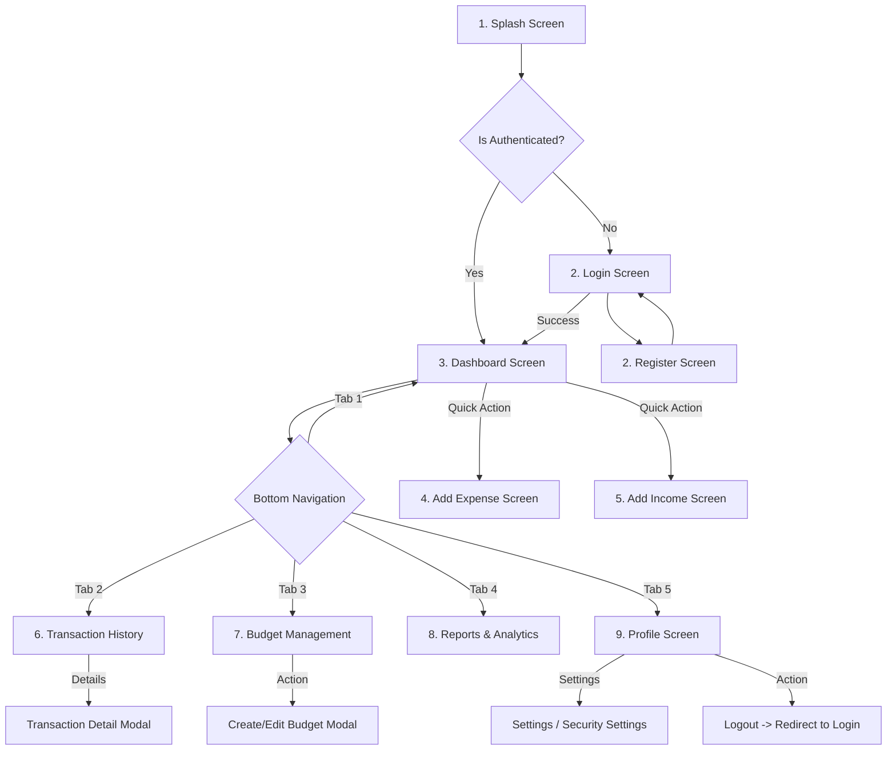
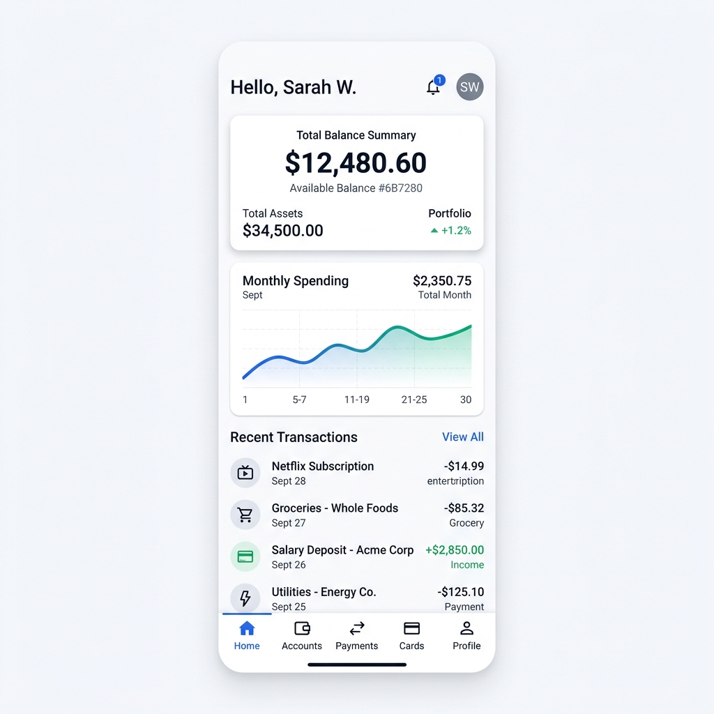
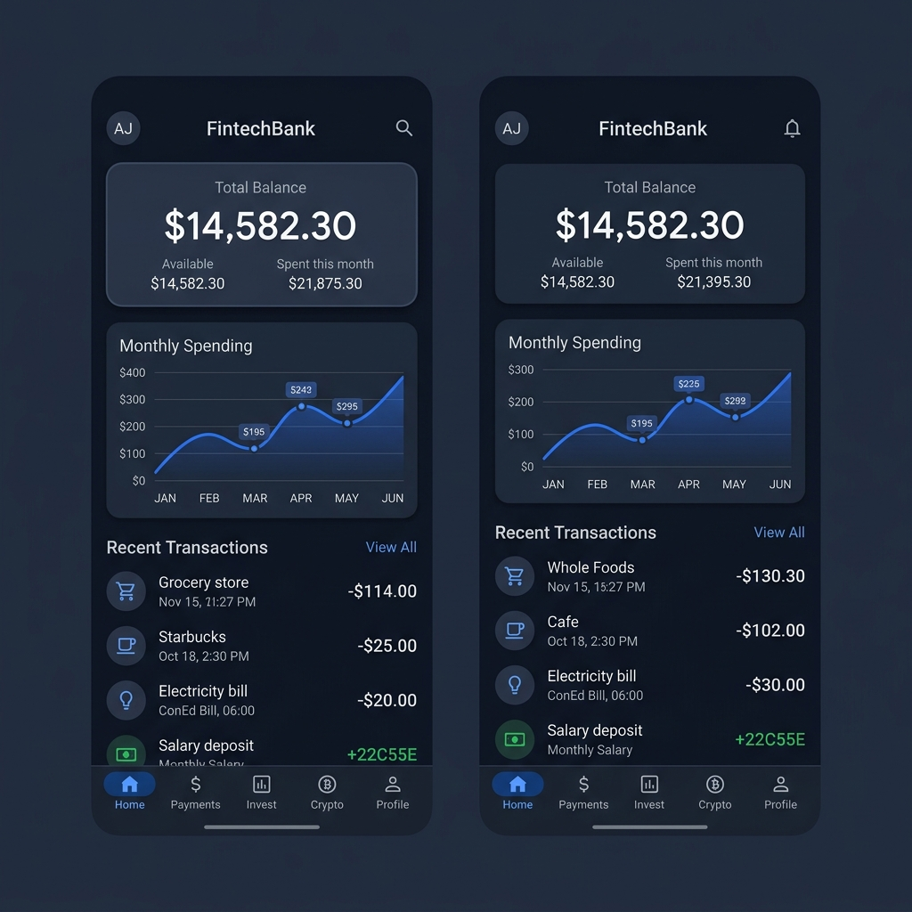

# Finance Management Application - UI Architecture & Design

A professional, modern, and clean FinTech Application design and codebase architecture for both **Flutter** and **React Native**.

---

## 1. Design System & Theme

### Color Palette
* **Primary Color**: `#2563EB` (FinTech Blue) - Used for primary buttons, active tabs, and navigation headers.
* **Secondary Color**: `#10B981` (Emerald Green) - Used for income, success states, and positive trends.
* **Background**: `#F8FAFC` (Slate Light Background)
* **Card Background**: `#FFFFFF` (Pure White) - For high-contrast element nesting.
* **Text Primary**: `#0F172A` (Slate 900) - For clear readable headings.
* **Text Secondary**: `#64748B` (Slate 500) - For secondary information and captions.
* **Success**: `#22C55E` | **Warning**: `#F59E0B` | **Danger**: `#EF4444`

---

## 2. Navigation Flow Diagram

The application uses a tab-based navigation layout for the primary screens after successful authentication, with modal/stack navigations for transactions and profile setups.



---

## 3. UI Wireframes

### Dashboard Wireframe (Layout Structure)
```
+---------------------------------------------------+
|  [Avatar] Welcome, Alex!             [Notification]
+---------------------------------------------------+
|  +---------------------------------------------+  |
|  |  TOTAL BALANCE                              |  |
|  |  $12,854.20                                 |  |
|  |                                             |  |
|  |  [Monthly Income]        [Monthly Expense]  |  |
|  |  +$4,820.00 (Sec.)       -$2,140.00 (Dang.) |  |
|  +---------------------------------------------+  |
+---------------------------------------------------+
|  QUICK ACTIONS                                    |
|  [+ Expense]   [+ Income]   [Transfer]   [Budget] |
+---------------------------------------------------+
|  SPENDING BAR CHART                               |
|  [  ||||| Monthly Comparison Visualization  ]     |
+---------------------------------------------------+
|  RECENT TRANSACTIONS                   [View All] |
|  (Icon) Groceries    -$54.20    Transport  -$12.00 |
|  (Icon) Salary       +$2,400    Shopping   -$89.90 |
+---------------------------------------------------+
|  [Home]  [Transactions]  [Budget]  [Reports]  [Profile]
+---------------------------------------------------+
```

### Add Expense / Income Wireframe
```
+---------------------------------------------------+
|  [Back]             Add Transaction        [Save] |
+---------------------------------------------------+
|  Amount                                           |
|  $ 0.00                                            |
|                                                   |
|  Title / Source                                   |
|  [ e.g. Weekly Groceries / Salary Paycheck     ]  |
|                                                   |
|  Category                                         |
|  [ Select Category (Dropdown)                  v] |
|                                                   |
|  Date                                             |
|  [ Select Date (DatePicker)                  [x] ] |
|                                                   |
|  Notes                                            |
|  [ Enter additional details...                 ]  |
|                                                   |
|  Receipt Upload (Expense Only)                    |
|  +---------------------------------------------+  |
|  |           [Upload Receipt Image]            |  |
|  +---------------------------------------------+  |
+---------------------------------------------------+
```

---

## 4. Reusable Components List

Both codebase targets (Flutter & React Native) are designed around the same modular component registry to maximize consistency:

| Component Name | Description | Reusable Properties / Props |
| :--- | :--- | :--- |
| `StatCard` | Display card for financial metrics (Balance, Savings, etc.) | `title: String`, `value: Double`, `trendPercent: Double`, `themeColor: Color`, `isPositive: Bool` |
| `ActionButton` | Primary buttons supporting loading states & custom styling | `label: String`, `onPressed: Function`, `isLoading: Bool`, `variant: Primary/Secondary/Outline` |
| `TransactionTile` | Transaction list item card | `title: String`, `amount: Double`, `category: String`, `date: DateTime`, `isExpense: Bool` |
| `InputField` | Standard Form inputs with field validation, icons, and error handling | `label: String`, `placeholder: String`, `isObscure: Bool`, `keyboardType: TextInputType`, `errorText: String?` |
| `InteractiveChart`| Canvas/SVG based wrapper to display Pie charts and Bar charts | `chartData: List<Point>`, `type: Bar/Pie`, `height: Double` |
| `ProgressTracker` | Custom linear progress indicator to show budgets vs spending | `spent: Double`, `total: Double`, `category: String` |

---

## 5. Component Hierarchy

A visual representation of the widgets layout:

```
AppRoot (AppEntry / Main)
 └── ThemeProvider (Handles Light/Dark Mode)
      └── NavigationProvider (Router / TabNavigator)
           ├── ScreenContainer (Safe Area, Scroll Handling, Responsive Layout)
           │    ├── AppHeader (Profile Pic, Notification Counter, Greetings)
           │    │    └── AvatarWidget
           │    ├── CardContainer
           │    │    └── StatCard (Balance / Income / Expenses)
           │    ├── ChartContainer
           │    │    └── ExpenseBarChart / PieChart
           │    ├── TransactionList
           │    │    └── TransactionTile
           │    └── QuickActionGrid
           │         └── ActionIconButtons
           └── BottomNavBar (Standard Screen Switching Navigation)
```

---

## 6. Responsive Design & Dark Mode Guidelines

### Responsive Design Checklist
1. **Grid Layouts**: Multi-column grids for tablet resolutions (e.g., Summary cards split into 2x2 grid on phone, 1x4 on tablet).
2. **Dimension Wrapping**: Avoid hardcoded padding/margins. Use proportional sizing relative to viewport height/width:
   - *React Native*: Custom hook using `useWindowDimensions()` or dynamic percentage-based paddings.
   - *Flutter*: Using `LayoutBuilder` and `MediaQuery`.
3. **Typography Scaling**: Scale fonts dynamically. In Flutter, use `TextTheme` with proportional `fontSize`. In React Native, adjust font scaling using standard viewport width calculations.

### Dark Mode Support
* Themes map colors standardly:
  * Slate Light `#F8FAFC` maps to Deep Navy `#0F172A`.
  * Pure White `#FFFFFF` cards map to Slate Charcoal `#1E293B`.
  * Text Colors swap cleanly: Text Primary becomes `#F8FAFC`, Text Secondary becomes `#94A3B8`.
* Brand colors (Blue & Green) retain high contrast using subtle opacity styling rather than changing baseline hues.

---

## 7. High-Fidelity Mobile UI Mockups

### Light Mode Dashboard


### Dark Mode Dashboard


### Authentication Screen

